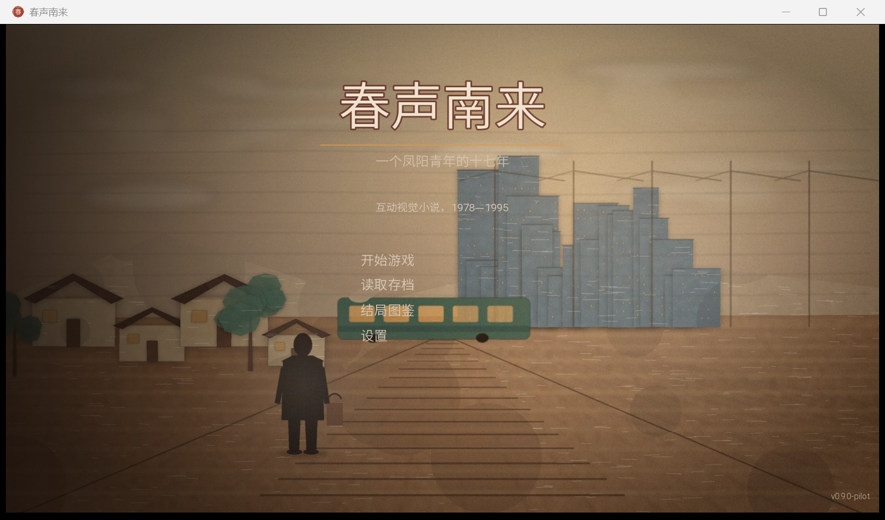
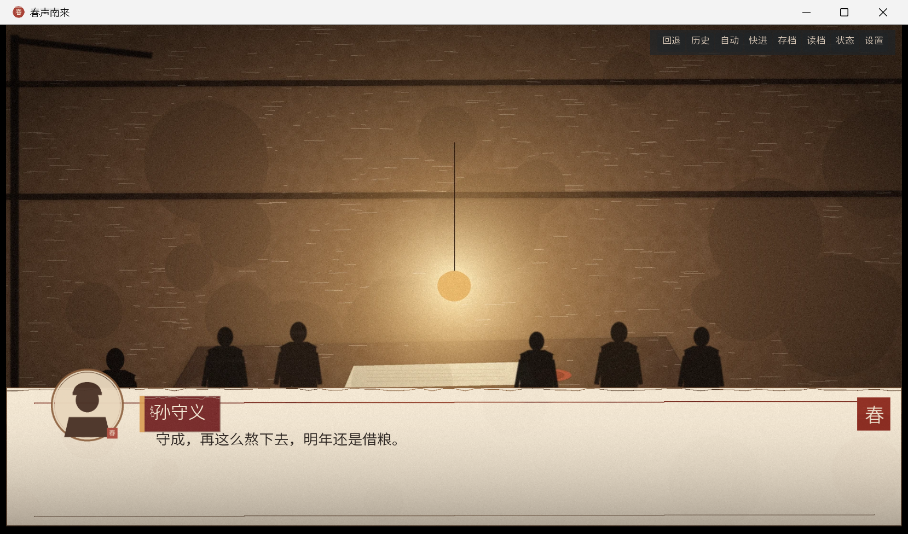

# 红卫的春天 · Ren'Py 互动视觉小说（0.9.0-pilot）

一个凤阳青年的十七年。1978—1995，从红手印到春声收音机。

本项目基于《红卫的春天》优化稿与支线数值文档改编，包含完整主线、20 个选择点、五项数值、关键 flag、9 个结局和一套可替换的纸雕/水彩概念美术。





---

## 一、快速开始

### 方式 A：Ren'Py Launcher

1. 打开 Ren'Py 8.5.3 SDK；
2. 在启动器中选择本目录 `chunsheng_nanlai`；
3. 点击“启动项目”。

### 方式 B：命令行

```powershell
# 在普通桌面环境
& "D:\renpy\renpy-8.5.3-sdk\lib\py3-windows-x86_64\python.exe" `
  "D:\renpy\renpy-8.5.3-sdk\renpy.py" `
  "D:\try_deepseek_harness\chunsheng_nanlai" run
```

如果当前环境限制了 `AppData\Roaming\RenPy` 写入，先设置：

```powershell
$env:RENPY_PATH_TO_SAVES = "D:\try_deepseek_harness\chunsheng_nanlai\saves_root"
```

### 方式 C：Lint

```powershell
$env:RENPY_PATH_TO_SAVES = "D:\try_deepseek_harness\chunsheng_nanlai\saves_root"
& "D:\renpy\renpy-8.5.3-sdk\lib\py3-windows-x86_64\python.exe" `
  "D:\renpy\renpy-8.5.3-sdk\renpy.py" `
  "D:\try_deepseek_harness\chunsheng_nanlai" lint
```

当前 lint 结果：**通过**，20 menus / 667 dialogue blocks / 20 screens。

---

## 二、操作

| 操作 | 按键 |
|---|---|
| 推进对话 | 鼠标左键 / Enter / Space |
| 回退 | 鼠标滚轮上 / 快速菜单“回退” |
| 历史 | 快速菜单“历史” |
| 自动 | 快速菜单“自动” |
| 快进 | Ctrl / 快速菜单“快进” |
| 存档/读档 | 快速菜单“存档/读档” |
| 状态 | 快速菜单“状态” |
| 设置 | 快速菜单“设置” |
| 全屏 | Alt+Enter / 设置 |

---

## 三、项目结构

```
chunsheng_nanlai/
  game/
    script.rpy         主线、20 个选择、章节差分
    endings.rpy        固定加成、结局判定、9 个结局
    definitions.rpy    角色、头像映射、数值、flag、转场
    screens.rpy        对话、选择、菜单、状态、图鉴、章节卡、结局卡
    gui.rpy            1920×1080 基础参数
    options.rpy        项目配置、DPI、音频、存档目录
    images/bg/         29 张背景 + 9 张结局背景（WEBP）
    images/portraits/  10 张角色印章头像（PNG）
    gui/               UI 图片
    audio/             9 段程序化环境音/音效（WAV）
    fonts/             思源黑体 Lite（开源）
  tools/               程序化美术/音频生成脚本
  preview/             运行截图
  GAME_DESIGN.md       游戏设计文档
  ART_BIBLE.md         美术圣经与出图提示词
  README.md            本文件
```

---

## 四、首版美术说明

首版采用 **“纸雕剧场 / 水彩记忆”** 概念美术：

- 29 张背景 + 9 张结局背景，全部 1920×1080；
- 人物以剪影和 320×320 印章头像出现；
- 风格统一、可替换，正式版按 `ART_BIBLE.md` 的提示词逐张替换为水彩厚涂插画即可，不改代码；
- 没有做 60—80 张角色立绘，这是首版的范围取舍，不是遗漏。`say` 屏幕与 `portrait_map` 已留好接口，后续可接半身立绘。

---

## 五、当前范围

### 已实现

- 序章—第七章—终章完整主线；
- 20 个选择点、五项数值、关键 flag；
- 9 个结局 + 结局图鉴；
- 6 个存档槽；
- 状态面板、历史、设置、自动/快进；
- 章节卡、结局卡；
- 程序化环境音；
- 1920×1080 适配与高 DPI 修正。

### 未实现（正式版再做）

- 角色半身立绘与表情差分；
- 全语音；
- 修理/质检小游戏；
- 多语言；
- Steam 成就与云存档；
- 历史顾问审读。

---

## 六、已知问题

1. **首版美术是概念级**：纸雕/水彩叠层，细节密度低于手绘厚涂；正式版需整包替换，避免混搭。
2. **南巡场景为虚构化处理**：用“远观+听片段/读报”避免虚构领导人公开演讲；正式版建议请历史顾问复核。
3. **数值阈值仍需真人测试**：当前基于文档 2 的建议值，建议在第四章后加一次中期结算提示。
4. **高 DPI**：已用 `config.de_minimus_dpi_scale = 3.0` 强制 1:1 虚拟像素；如在 4K/250% 屏幕上仍有偏移，可在 `options.rpy` 调整。
5. **首版无立绘**：角色以印章头像出现；如果直接替换为立绘，需要同步调整 `screen say` 的头像位置与对话区宽度。

---

## 七、素材与许可

- 引擎：Ren'Py 8.5.3（MIT/Artistic 等，详见 Ren'Py 发行说明）。
- 字体：`SourceHanSansLite.ttf`，来自 Ren'Py SDK 的思源黑体 Lite，SIL Open Font License。
- 背景/头像/UI：本项目 `tools/make_art.py`、`tools/make_ui.py` 程序化生成的概念美术；可自由替换。
- 音频：本项目 `tools/make_audio.py` 程序化生成；可自由替换。
- 剧本：基于用户提供的《红卫的春天》文本与支线数值文档改编。

---

## 八、下一步建议

1. 先做 3—5 位真实玩家的 30 分钟试玩，记录他们在 S5、S10、S12、S17 的停留与选择；
2. 根据试玩调整“召回后资金过低”的曲线，必要时提高固定加成或降低建厂成本；
3. 先替换 8 张关键背景（主菜单、堂屋、列车、夜校、国贸、旧仓库、返乡、结局 E1），验证正式美术风格；
4. 再决定是否做立绘：如果做，优先孙红卫、苏文静、父亲、大伯四人；
5. 最后再扩写文本到 3—5 万字，不要先铺量。
